# NEWT round 3: element rings

Before: main `6c46a54ac1a00aea4ee037150e485cbd322c8c68`, captured from an isolated checkout with identical source. After: implementation commit `7c758a7` in this PR. Both use the default NEWT world camera and ordinary animation speed, with Chrome/SwiftShader. Desktop viewport: 1280 × 800; phone: 390 × 844 with coarse touch input. Images are the native low-resolution canvas, without resampling. Particle rolls vary between runs.

Each WebM records 0.4 seconds before the public ring action and 3 seconds afterward through the canvas capture stream at 30 fps. No animation clock was frozen or accelerated. Stills sample fire/lightning about 0.2 seconds after the action and ice about 0.65 seconds afterward. The normal render passes remain enabled.

| View | Before | After | Real-speed clips |
| --- | --- | --- | --- |
| Dusk fire | 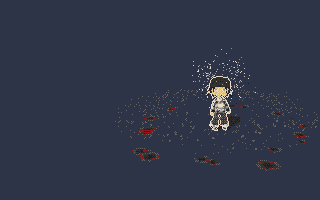 | 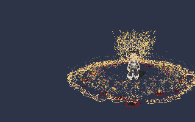 | [Before](before-dusk-fire-1280.webm) · [After](after-dusk-fire-1280.webm) |
| Dusk lightning | 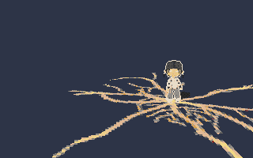 | 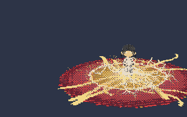 | [Before](before-dusk-lightning-1280.webm) · [After](after-dusk-lightning-1280.webm) |
| Dusk ice | 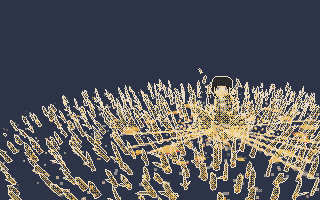 | 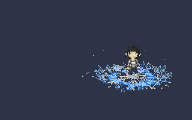 | [Before](before-dusk-ice-1280.webm) · [After](after-dusk-ice-1280.webm) |
| White ice | 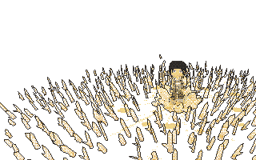 | 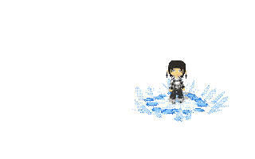 | [Before](before-white-ice-1280.webm) · [After](after-white-ice-1280.webm) |
| White ice, phone | 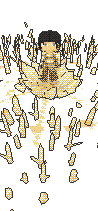 |  | [Before](before-white-ice-390.webm) · [After](after-white-ice-390.webm) |

The ice field stays below NEWT's upper body, fits the phone frame, and uses cold colors. Paper gold, the red seal, and NEWT's palette slots remain unchanged. Fire and lightning retain their original reach.

| Additional check | Before | After |
| --- | --- | --- |
| Dusk trousers at rest |  | 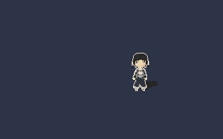 |
| Sealed ice invitation | 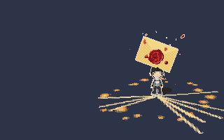 | 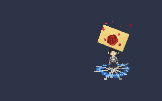 |
| Open ice invitation | 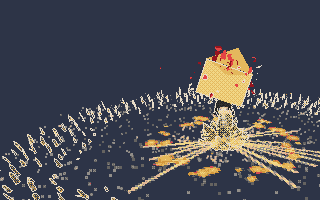 | 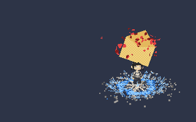 |
| Reduced-motion Cream fade | 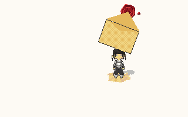 | 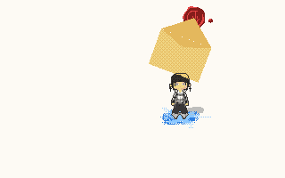 |

The reduced-motion captures use the actual fading state with fade greater than 0.45, dissolve zero, and outlines enabled. The regression tests additionally sample scorch darkness at 5.2, 5.5, 10, and 14 real seconds on Dusk, White, and Cream; these short clips do not claim to cover that full interval. PR validation records the rendered assertions and demonstrated reverted-fix failures.

## Camera integration supplement

These three additional native-canvas stills use the final integration of camera main `15484cc` with the ring/movement fixes, including the coarse-pointer ice width of 0.4. They match the source in the merge commit containing these files. They are not replacements for the earlier `7c758a7` before/after clips above. Normal render passes, the default Page camera, and ordinary animation time are retained; fire is sampled around 0.2 seconds and ice around 0.65 seconds after the ring action.

| Integrated Dusk fire, desktop | Integrated White ice, phone | Integrated White ice, walking phone |
| --- | --- | --- |
| 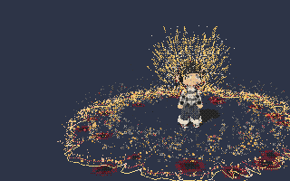 |  |  |

The walking capture uses the actual root at approximately `(0.124, 0, -0.615)`, after waiting for normal movement away from the origin. The phone regression checks both a fresh page and this moving setup. The final combined-main real-speed show is reviewed separately; these stills specifically document the camera integration and phone field clearance.
